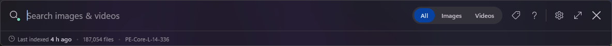
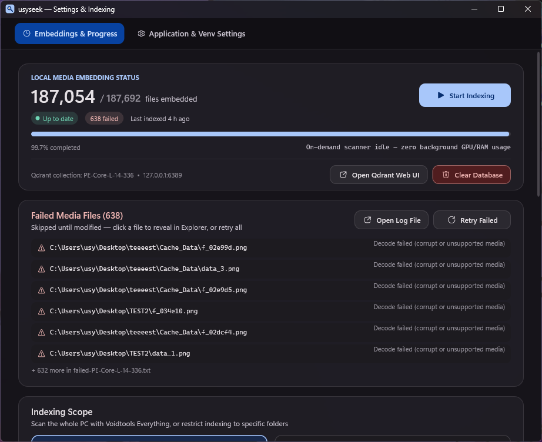
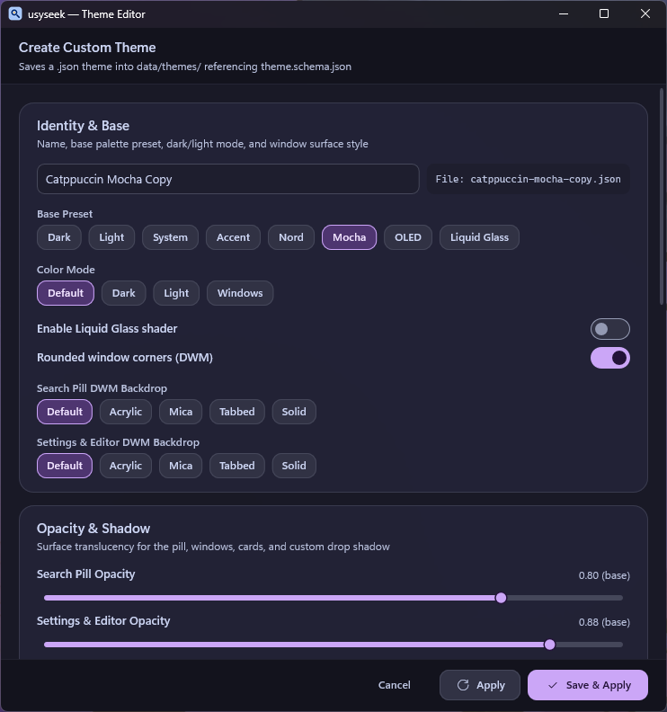

<h1 align="center">usyseek</h1>
<h3 align="center">Local AI-Powered Semantic Desktop Search for Windows</h3>

> [!IMPORTANT]
> **Notice: This entire application, architecture, and codebase is 100% AI-generated.**

- **100% On-Device & Privacy-First**: All scanning, decoding, embedding, vector storage, and search inference run locally. Zero telemetry, zero analytics, zero cloud dependencies.
- **No System-Wide Python Dependency**: System Python is completely optional. A self-contained portable Python runtime can be downloaded and managed directly from the Settings UI with one click.
- **Found a bug or have a suggestion?** Feel free to open an issue or reach out to `@usy_` on Discord!
- **Contributions are welcome**: PRs and improvements will always be considered!

---

## Overview

**usyseek** is a modern, high-performance semantic desktop search engine for Windows 10/11 built with **C++23**, **Rust**, **Direct2D**, and **PyTorch**.

Instead of relying solely on file names or manually tagged metadata, `usyseek` allows you to search your entire local image and video library using natural language descriptions (e.g., *"sunset over snowy mountain"*, *"cyberpunk street in the rain"*, *"diagram with purple flowchart"*), visual similarity (*"Find Similar"*), directory path scoping, and interactive color-coded tags.

Designed around a decoupled multi-process architecture, `usyseek` delivers instant Spotlight search capabilities while maintaining a virtually zero-byte idle memory footprint.

---

## Architecture & Process Model

To avoid the massive idle resource consumption common to AI and Electron-based desktop utilities, `usyseek` splits responsibilities across dedicated processes coordinated via Windows Job Objects, shared memory, and window messages:

```
                  ┌────────────────────────────────────────┐
                  │              usyseek.exe               │
                  │   (Lightweight Launcher & Tray Icon)   │
                  │   Global Hotkey • Process Supervision  │
                  └───────┬────────────────────────┬───────┘
                          │ (on hotkey / search)   │ (on index start)
                          ▼                        ▼
        ┌───────────────────────────┐    ┌───────────────────────────┐
        │       usyseek-ui.exe      │    │    usyseek-indexer.exe    │
        │  • Direct2D / DirectWrite │    │  • Everything3 SDK        │
        │  • Spotlight Search Pill  │    │  • WIC / Media Foundation │
        │  • ONNX Runtime Text Tower│    │  • Zero-copy Shared Memory│
        │  • qdrant-edge (Embedded) │    │  • qdrant-edge (Embedded) │
        │  • Exits on idle timeout  │    │  • Exits when scan finishes│
        └───────────────────────────┘    └─────────────┬─────────────┘
                                                       │ Shared Memory IPC
                                                       ▼
                                         ┌───────────────────────────┐
                                         │    usyseek_vision.py      │
                                         │  • PyTorch Vision Tower   │
                                         │  • ROCm / CUDA / CPU      │
                                         │  • Portable Python Worker │
                                         └───────────────────────────┘
```

1. **`usyseek.exe` (Launcher & Supervisor)**:
   - Always-running background supervisor (~3–5 MB working set, trimmed on idle).
   - Manages the system tray icon, global hotkey (default: `Alt + Space`), and process lifecycles.
   - Enforces a `KillOnClose` Windows Job object so background helpers never leak when quitting.

2. **`usyseek-ui.exe` (Search Pill, Settings & Theme Editor)**:
   - Hardware-accelerated UI rendered with **Direct2D**, **DirectWrite**, **DirectComposition**, and **DXGI**.
   - Features a floating Spotlight search pill, fullscreen media exploration grid, tag editor, settings interface, and live custom **Theme Editor** following a flat **Material 3 (M3)** design system (with optional real-time **Liquid Glass** refraction via DXGI Desktop Duplication).
   - Runs **ONNX Runtime (CPU)** to encode text queries on-the-fly into vector embeddings using the exported text tower and fast Hugging Face tokenizers.
   - **Zero-Footprint Idle**: After `ui_idle_timeout_s` of inactivity while hidden (default: 180 seconds), the UI process exits cleanly, releasing all GUI and ONNX resources back to the OS.

3. **`usyseek-indexer.exe` (Scanner & Embedding Pipeline)**:
   - On-demand worker process that exists only while indexing is active.
   - Integrates with **Voidtools Everything** via the **Everything3 SDK** (`uk.usyless.usyseek`) for instant NTFS file discovery across local drives.
   - Utilizes **Windows Imaging Component (WIC)** for high-throughput image decoding, **resvg** for SVG / SVGZ rasterisation and **Media Foundation (MF)** for multi-threaded video keyframe extraction.
   - **Zero C++ Python Dependency**: Completely decoupled from CPython at compile and link time (no `pybind11` or `python3XY.dll` link requirement). Communicates with an out-of-process Python worker (`usyseek_vision.py`) via zero-copy **named shared memory**, executing the vision tower on AMD (ROCm), NVIDIA (CUDA), or CPU.
   - Reports live progress, throughput, and status through shared memory (`Local\usyseek.indexer.status`).

4. **Embedded Vector Engine (`qdrant-edge`)**:
   - Powered by **`qdrant-edge`** embedded directly inside the `usyseek_rust` static library—no external `qdrant.exe` server or gRPC overhead.
   - Stores vector embeddings, payloads, and a centralized tags database locally on disk.

---

## Features

### 🔍 Spotlight Search Pill & Media Grid

<p align="center">
  
</p>

- **Movable & Draggable**: Freely drag the search pill anywhere on your desktop; screen positions are preserved across launches.
- **Live Edge Resizing**: Drag left and right pill edges to adjust width with real-time pixel tooltips, or double-click to snap back to default.
- **Fullscreen Mode**: Expand instantly from the pill into an immersive edge-to-edge media exploration view.
- **Uniform 16:10 Previews**: Crisp, uniform aspect ratio media cards with pinned bottom metadata (dimensions, file size, duration, and tags).
- **Find Similar (Visual Cosine Search)**: Click the "Similar" button on any image or video card to search your library for visually and semantically related items.
- **Interactive Media Previews**: Supports video and animated GIF playback directly in previews with seek controls, volume adjustment, and image/preview zooming.
- **Search History & Default Open Mode**: Navigate previous queries with text box history, and choose whether the app opens in Pill or Fullscreen mode by default.
- **Themes & Liquid Glass**: Customize the interface with 8 built-in themes (including **Liquid Glass** with multi-monitor & DPI-aware live desktop refraction) or build your own in the **Theme Editor**.
- **Directory Path Scoping**: Filter searches to specific folders or parent directories using `dir:...` or path autocompletion.
- **Media Kind Filters**: Filter seamlessly between All, Images, or Videos.

### 🏷️ Interactive Tagging System
- **Centralized Tags Database**: Tags are stored in a centralized database so your tags persist cleanly even when switching AI models.
- **Single-Line Tag Strip**: Color-coordinated M3 assist chips with `+N` overflow badges and hover tooltips.
- **Stamp Mode**: Toggle the Tag Ribbon to enter stamp mode—click any card in the grid to immediately add or remove the selected tag.
- **`tag:<name>` Autocomplete**: Type `tag:` into the search box for real-time autocomplete suggestions with color dots and live item counts.
- **Custom Tag Palette**: Create custom tags with an 8-color tonal Material 3 palette.

### ⚡ Blazing Fast Indexing
- **Voidtools Everything Integration**: Near-instantaneous filesystem crawling across whole PC drives (`C:\`, `D:\`, etc.) or selected directories.
- **Multi-Threaded Hardware Decoding**: Concurrent WIC image decoding and Media Foundation video frame sampling.
- **Vector Images**: SVG and SVGZ files are rendered with resvg (on white) for both embedding and thumbnails.
- **Configurable Video Keyframes**: Extracts configurable representative frames across videos (default: 8 frames) for semantic video retrieval.
- **Robust Exclusion Rules**: Pre-configured system rules (`C:\Windows`, `$Recycle.Bin`, `Program Files`, `AppData`) plus custom glob/path exclusions.

### ⚙️ Settings & Environment Management

<p align="center">
  
</p>

- **Interactive Global Hotkey Recorder**: Easily rebind the spotlight shortcut (e.g. `Alt + Space`, `Ctrl + Shift + Space`) or disable it entirely.
- **Models UI & Selection**: Dedicated Models UI supporting OpenCLIP and Perception Engine vision models (default: `PE-Core-L-14-336`). Automatically exports ONNX text towers for CPU search.
- **One-Click Model Download**: Settings fetches the weights and tokenizer from Hugging Face (default repository `timm/<model name>`) and stores them as `<model>.safetensors` and `<model>-tokenizer.json` in the model folder. Downloads resume after an interruption, and a model added while the app is running is picked up without a restart.
- **Zero-Setup Portable Python**: System-wide Python is **not required**. `usyseek` can download and bootstrap a self-contained portable Python runtime (via NuGet, supporting 3.14, 3.13, 3.12, 3.11) with one click from Settings, or use an existing `.venv`.
- **Thumbnail Fit**: Show image thumbnails cropped to fill the tile (default) or as the whole image, letterboxed.
- **Hardware Acceleration**: Configure hardware acceleration (ROCm / CUDA / CPU) with custom PyTorch arguments directly within the UI.
- **Notifications, About & Auto-Updater**: Built-in notifications tab, About page, and automatic updates.

### 🎨 Themes, Liquid Glass & Theme Editor

<p align="center">
  
</p>

- **Built-In Presets & Windows Sync**: Switch between **Follow Windows**, **Windows Accent** (dynamically derived from your Windows accent color), **Midnight Dark**, **Daylight**, **Nord**, **Catppuccin Mocha**, **Pure OLED**, and **Liquid Glass**.
- **Built-In Theme Editor**: Create, duplicate, edit, or delete custom themes directly from **Settings → Appearance & Theme**, with **Apply** for instant live previewing and **Save & Apply** to persist to disk.
- **JSON Schema & Live Reload**: Custom themes live in `data/themes/*.json` alongside an auto-synced `theme.schema.json` (for editor autocomplete/validation) and `example-sakura (copy but do not edit).json`, with **Open Folder** and **Reload** actions in Settings.
- **Surfaces, Radii & Shadows**: Customize dark/light/system polarity, DWM backdrops (`Acrylic`, `Mica`, `Tabbed`, `Solid`) independently for the search pill and settings/editor windows, surface opacities, drop shadow scale, and custom **Corner Radii** for the search pill, cards, buttons, and thumbnails.
- **Tunable Liquid Glass Material**: Enable the Direct2D/DXGI **Liquid Glass** shader on any custom theme and fine-tune blur, superellipse corner roundness, index of refraction, chromatic dispersion, glare scale, and glare angle—complete with multi-monitor, display rotation, and DPI scaling support.
- **Full Palette & Tag Colors**: Edit core and advanced Material 3 color tokens plus all 8 cyclic **Tag Palette** colors using native Windows color pickers or `#RRGGBB` / `#RRGGBBAA` hex inputs, with per-property reset controls.

---

## First Launch Guide

1. **Download the AI Model**: Open **Settings** (from the tray icon or search pill) and click the download button to fetch the vision/text model weights and tokenizer.
2. **Download Portable Python**: In Settings, click to download the self-contained portable Python runtime (no system Python needed).
3. **Select GPU Architecture & Variant**: Pick your GPU architecture (**AMD ROCm**, **NVIDIA CUDA**, or **CPU**), then select your specific GPU architecture / CUDA version (e.g., `gfx1030` or `cu126` / `cu130` / `cu132` / `cu134`) or model variant.
4. **Download Python Packages**: Click to install the required Python packages (PyTorch, etc.) into the portable environment. Once complete, you're ready to start indexing!

---

## Shortcuts & Controls

| Shortcut / Action | Function |
| :--- | :--- |
| <kbd>Alt</kbd> + <kbd>Space</kbd> | Toggle Spotlight Search Pill (customizable in settings) |
| <kbd>Esc</kbd> | Dismiss search pill, close settings window, or exit fullscreen |
| **Drag Top/Handle** | Move the Spotlight search pill around the desktop |
| **Drag Side Edges** | Resize search pill width |
| **Double-Click Edge** | Reset search pill to default width (780px) |
| **Left-Click Tray Icon** | Toggle Spotlight Search Pill |
| **Right-Click Tray Icon** | Open Win32 context menu (Search, Settings, Start/Stop Index, Quit) |

---

## System Requirements

- **Operating System**: Windows 10 (version 1809+) or Windows 11 x64
- **C++ Compiler**: MSVC from Visual Studio 2022 (v143+) supporting C++23 (`/std:c++latest`)
- **CMake**: `3.31+`
- **Build System**: [Ninja](https://github.com/ninja-build/ninja)
- **Rust Toolchain**: `cargo` / `rustc` 1.85+ (used to compile the `usyseek_rust` static library)
- **Python**: **Not required!** System-wide Python is no longer a dependency. The application can automatically download and manage a portable Python runtime directly from the Settings UI (or you can optionally point it to an existing virtualenv / local install).
- **GPU (Optional but recommended for indexing)**:
  - **AMD**: ROCm for Windows (default target: `gfx1030` / RDNA2+)
  - **NVIDIA**: CUDA 12.6+ (wheel variant `cu126`, `cu130`, `cu132` or `cu134`, pickable in Settings)
  - **CPU**: Supported for both indexing and search fallback

---

## Building from Source

### 1. Environment Setup

Ensure MSVC, CMake, Ninja, and Rust (`cargo`) are available in your `PATH`. Python is **not needed** to build `usyseek`. If you use portable development environments, you can configure them via `build.bat` or load your environment scripts.

### 2. CMake Build

Alternatively, configure and build using CMake directly:

```cmd
cmake -S . -B build -G Ninja ^
    -DCMAKE_BUILD_TYPE=Release ^
    -DCMAKE_C_COMPILER=cl ^
    -DCMAKE_CXX_COMPILER=cl ^
    -DCMAKE_EXPORT_COMPILE_COMMANDS=ON

cmake --build build --parallel
```

### 3. Build Output Layout

All built executables, dependencies, and runtime assets are automatically assembled in `build/bin/`:

```
build/bin/
├── usyseek.exe              # Launcher and tray supervisor
├── usyseek-ui.exe           # Search pill & settings UI (with embedded qdrant-edge)
├── usyseek-indexer.exe      # Indexing and embedding engine (with embedded qdrant-edge)
├── onnxruntime.dll          # ONNX Runtime (CPU)
└── python/
    ├── usyseek_vision.py    # PyTorch vision tower worker
    └── requirements.txt     # Python dependencies
```

---

## CMake Configuration Flags

| Option | Default | Description |
| :--- | :--- | :--- |
| `USYSEEK_USE_MIMALLOC` | `ON` | Replace the default allocator with Microsoft `mimalloc` |
| `USYSEEK_USE_INTERPROCEDURAL_OPTIMIZATION` | `ON` | Enable Link-Time Optimization (LTO/LTCG) |
| `USYSEEK_USE_STATIC_MSVCRT` | `ON` | Link against static MSVC runtime (`/MT`) |
| `USYSEEK_BUILD_MIGRATE` | `OFF` | Build temporary Qdrant-to-Edge migration tool (`usyseek-migrate.exe`) |
| `USYSEEK_USYLIBPP_VERSION` | `main` | Git branch/tag for `usylibpp` |
| `USYSEEK_GLAZE_VERSION` | `v9.1.0` | Git tag for `glaze` (high-performance JSON) |
| `USYSEEK_MIMALLOC_VERSION` | `v3.5.3` | Git tag for `mimalloc` |
| `USYSEEK_ORT_VERSION` | `1.32.0` | Prebuilt ONNX Runtime Windows x64 release |
| `USYSEEK_EVERYTHING_VERSION` | `1.5.0.1424b` | Voidtools Everything x64 portable release |
| `USYSEEK_SQLITE_VERSION` | `3540100` | SQLite amalgamation release |

---

## Interactive UI Mockup

An interactive, browser-based prototype of the Material 3 search pill and settings interface is included under [`mockup/`](./mockup):

- Double-click [`mockup/index.html`](./mockup/index.html) or run [`mockup/run_mockup.bat`](./mockup/run_mockup.bat)
- Or start a local server:
  ```bash
  python mockup/serve.py
  ```
  and visit `http://localhost:5173/index.html`.

---

## Getting Help & Community

- **Found a bug?** Open an issue on GitHub.
- **Questions or ideas?** Reach out to `@usy_` on Discord.
- Pull requests and contributions are always welcome!
